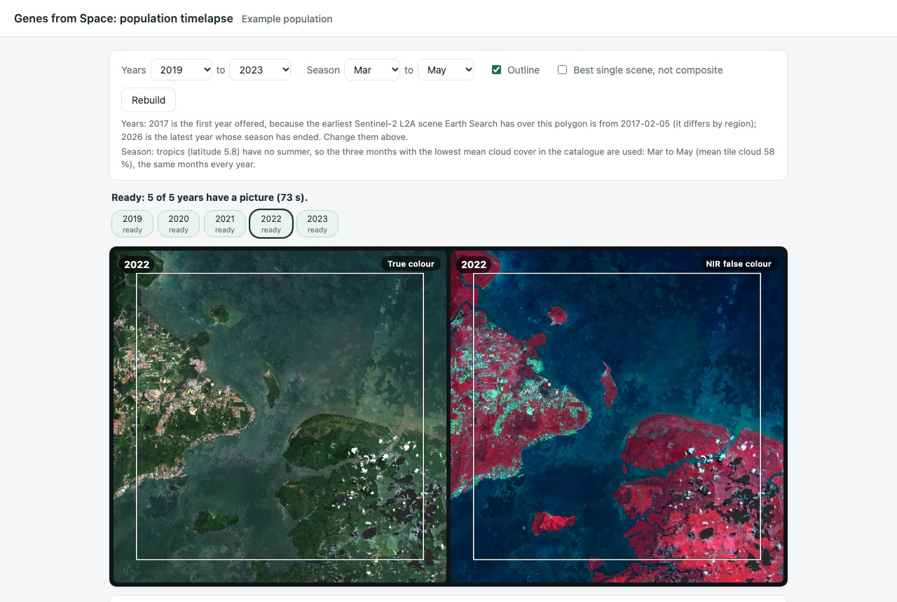

# GfS: population timelapse for the Genes from Space tool

**Open it:** https://braakhekke.github.io/GfS/ · **Try the Results page mockup:** https://braakhekke.github.io/GfS/mockup/results.html

A companion page for the [Genes from Space tool](https://www.gfstool.com/) (project: [UZH](https://www.geo.uzh.ch/en/units/sg/news/genes-from-space.html), [genesfromspace.com](https://www.genesfromspace.com/)). Pick one population polygon and the page plays a Sentinel-2 timelapse of that place, one picture per year, so you can see how the habitat has changed.

## What it does

- **One clear picture per year.** For each year it picks the least cloudy Sentinel-2 scene in the growing season (in the tropics: the three months that are usually least cloudy). If no single scene is clear, it combines several scenes into a cloud-free composite.
- **True colour and near infrared.** Show the normal view, a false-colour view in which healthy vegetation is bright red, or both side by side.
- **Look closer.** Zoom and pan (both views move together), measure distances and areas, and play at 0.5 to 8 frames per second.
- **Choose what to show.** Change the years and season, drop a year, or swap a composite for its best single scene. Each year lists the scenes it was made from, with links to their details in STAC Browser.
- **Take it with you.** Export the timelapse as video, GIF or PNG, at normal or high (10 m) resolution.
- **No waiting on a blank screen.** A cloud-free background map of the place shows until the first year is ready, and loading carries on while the tab is in the background.
- **Free and private.** Runs entirely in your browser: no server, no account, no key. Pictures already loaded are kept in your browser, so a second visit is faster.

## How to use it

From the mockup, click a population on the map and choose *Open timelapse*, or draw your own polygon or rectangle (at most 60 × 60 km) and open that. *Pick a population* on the timelapse page takes you back. Or link to the page directly with a polygon or a bounding box in the address, for example:

https://braakhekke.github.io/GfS/#bbox=118.05,5.75,118.25,5.95&name=Example%20population

The full link format (GeoJSON polygons, years, season) is in [docs/URL_CONTRACT.md](docs/URL_CONTRACT.md). Loading takes about a minute for five years, depending on the area and your connection.

## Status

Prototype. It is not yet part of the Genes from Space tool; the [mockup](https://braakhekke.github.io/GfS/mockup/results.html) shows how it could be linked from the Results page (invented polygons), and [docs/INTEGRATION.md](docs/INTEGRATION.md) proposes how to wire it in. Tested in Chrome; Safari, Firefox and phones have not been tested yet.

## Further reading

| Path | What |
|---|---|
| [docs/URL_CONTRACT.md](docs/URL_CONTRACT.md) | how to link to the page |
| [docs/INTEGRATION.md](docs/INTEGRATION.md) | proposal for connecting it to the Results page |
| [docs/DECISIONS.md](docs/DECISIONS.md) | every design choice and open question, with evidence |
| [docs/TOOL_WALKTHROUGH.md](docs/TOOL_WALKTHROUGH.md) | what the tool's pages show |
| [docs/CACHING_OPTIONS.md](docs/CACHING_OPTIONS.md) | where loading time goes and how it could be cut |

## Data and credits

Contains modified Copernicus Sentinel data, read from the public AWS Open Data copy through Earth Search (Element 84). The terms of use of these services have not been reviewed yet (DECISIONS Q-08). Background map while loading: [EOxCloudless](https://cloudless.eox.at) 2024 by EOX IT Services GmbH, [CC BY-NC-SA 4.0](https://creativecommons.org/licenses/by-nc-sa/4.0/) (non-commercial use only, DECISIONS Q-13); it is never part of the timelapse or the exports. Mockup map: © OpenStreetMap contributors, Leaflet, Leaflet-Geoman. Libraries: proj4js, geotiff.js.

## Licence

Not decided yet. Until a licence file is added, no permission to reuse is granted.
